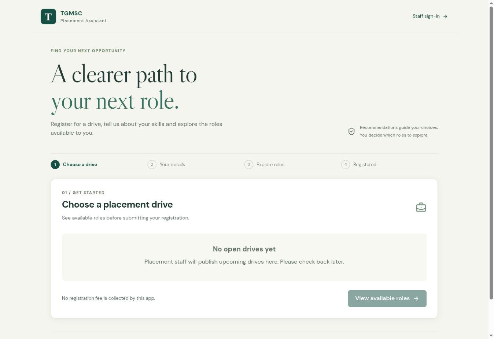
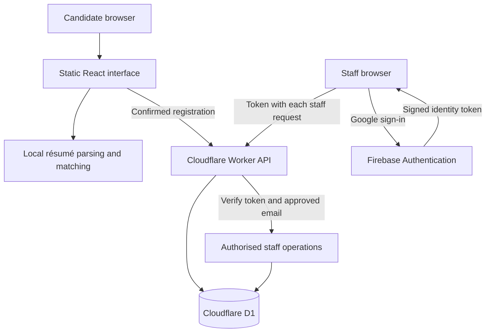

<div align="center">

# TGMSC Placement Assistant

**One registration. Clearer role choices. Better organised placement drives.**

A practical internship project for Telangana Minorities Study Circle, connecting candidate registration, browser-based résumé matching and staff operations in one application.

[Open the live app](https://tgmsc-placement-assistant.anwar7-akber.workers.dev/) · [How it works](#how-it-works) · [Run locally](#run-locally) · [Deployment guide](docs/DEPLOYMENT.md)


</div>



*Actual deployed interface. The screenshot shows the empty state between published drives; available opportunities are managed by placement staff.*

## The problem

Placement drives bring together candidates with different qualifications and companies hiring for different roles. A registration form can collect names, but it does not help someone understand which opportunities to explore—or give organisers a complete workflow for managing roles and following up.

At TGMSC, this also includes technology students considering non-IT opportunities. A useful assistant should help them discover options without making their degree background a barrier to exploring the drive.

This project turns that workflow into a single website: browse opportunities, confirm a profile, explore suggestions and register once for the selected drive. Staff manage the information behind those opportunities and the resulting registrations.

## What the application delivers

| For job seekers | For placement staff |
| --- | --- |
| Browse open drives and roles before providing personal details | Create and update drives, employers and job roles |
| Read a résumé or enter details manually | Specify qualifications, accepted graduation years and pursuing-student rules |
| Correct extracted information before using it | Access records through approved Google accounts |
| Compare profile text with role descriptions | Search, filter and page through registrations |
| See matched skills, missing details and stated requirements | Correct confirmed candidate details and role interests |
| Explore every open role, including options outside their background | Track attendance, interviews and follow-up |
| Select up to 20 interests, or register without selecting a role | Export all records or the current filtered selection as CSV |
| Receive a registration reference | Review recent record changes and remove registrations with confirmation |

**Recommendations support candidate choice. They do not reject applicants, send employer applications or promise an interview or job.**

## How it works

1. **Choose a drive.** Review the venue, reporting instructions and available roles.
2. **Confirm a profile.** Upload a supported résumé or fill in the form. Check contact details, skills, education and experience.
3. **Explore roles.** Compare suggestions, review requirements and select interests. All open roles in the drive remain available.
4. **Register.** Give consent and submit. Keep the reference for placement staff.

Staff use a separate workspace at `/staff`. Google sign-in establishes identity; the server checks an approved-email list before allowing access to records or changes.

### What the AI actually does

The application uses the pretrained **[all-MiniLM-L6-v2](https://huggingface.co/Xenova/all-MiniLM-L6-v2)** sentence-embedding model through Transformers.js. The bundled quantized ONNX model runs in the candidate's browser using WebAssembly.

It converts profile text and role descriptions into numerical representations, then compares them with **cosine similarity** to order suggestions. Mean pooling and vector normalisation are used during embedding extraction.

| Layer | What it checks |
| --- | --- |
| Text similarity | How closely skills, degree details and the profile summary relate to a role description |
| Skill comparison | Which listed role skills also appear in the candidate's confirmed skill list |
| Explicit requirements | Completed qualification, pursuing status, graduation batch and whole years of experience |
| Candidate choice | Which roles the person wants to explore, even when some requirements need discussion |

Degree or specialisation notes are displayed for organiser confirmation rather than treated as fully understood eligibility rules. Missing information stays unknown. A similarity score is **not a hiring probability**.

If the model is unavailable or slow to load, the interface offers clearly labelled **basic text matching**. Registration can continue through that path. No task-specific model was trained for this project, and no paid generative AI API is required.

### Résumé handling

- Supported: text-based PDF, DOCX and TXT, up to **5 MB**; PDFs are limited to **12 pages**.
- PDF.js and Mammoth extract text locally; simple rules suggest draft contact fields and recognised skills.
- Qualification and experience require candidate confirmation. Scanned PDFs and images need manual entry.
- The original file stays on the device. Confirmed profile fields—including the editable summary—and selected interests are sent to the application database after consent.

## Architecture



Static assets and `/api/*` share one origin. Static requests bypass the Worker; the API handles database operations and staff authorisation. The embedding model runs in the browser rather than on the Worker.

## Technology choices

| Technology | Responsibility | Reason for the choice |
| --- | --- | --- |
| React, TypeScript and Vite | Candidate and staff interfaces | Shared components, typed data and a static deployment |
| Vanilla CSS and Lucide icons | Responsive layout and controls | A small, consistent visual system without a UI framework |
| Cloudflare Workers and D1 | API and relational records | One hosting platform for the application and its database |
| Firebase Authentication | Staff Google sign-in | Managed identity without building a password system |
| `jose` | Server verification of Firebase tokens | Signature, project, expiry and identity checks before staff access |
| Transformers.js and ONNX WebAssembly | Browser-based semantic matching | Reuse a pretrained model without a separate inference server |
| PDF.js and Mammoth | Résumé text extraction | Established parsers for supported document formats |
| Zod and Drizzle tooling | Input validation and schema migrations | Consistent data checks and versioned database changes |

The design targets a free-tier pilot with Cloudflare and Firebase. Provider limits still apply; capacity and operating costs should be reviewed as usage grows. There is no paid AI service dependency.

## Privacy and access

- Candidate browsing and registration do not require an account.
- Staff endpoints verify signed Google identities and the server-side `STAFF_EMAILS` allowlist. Google sign-in alone does not grant staff access.
- API responses and exports use `Cache-Control: no-store`; tokens travel in request headers rather than export links.
- Database queries bind user values. Registration retries use a request identifier, and duplicate checks account for shared family phone numbers.
- CSV cells are escaped, including potentially dangerous spreadsheet formulas.
- Staff changes record the actor, action, record ID and time. Profile contents are not copied into that history.
- Real `.env` and `.dev.vars` files are ignored by Git; the committed examples contain blank values.

These are implemented controls, not a claim of independent security certification. Dependency advisories and operational access settings need ongoing review. See the [deployment and maintenance guide](docs/DEPLOYMENT.md).

## Run locally

Use **Node.js 24**, **pnpm 11.25.0**, and **Python 3 available as `python`** for the database regression test.

```sh
git clone https://github.com/Anwar-Qureshi/tgmsc-placement-assistant.git
cd tgmsc-placement-assistant
pnpm install --frozen-lockfile
```

Create `.env` from [`.env.example`](.env.example) and `.dev.vars` from [`.dev.vars.example`](.dev.vars.example). Supply your own Firebase web configuration and local approved staff emails. For local sign-in, enable Google in Firebase and add `localhost` to its authorised domains.

```sh
pnpm db:local
pnpm dev
```

Open the URL printed by Vite. The local database starts empty; an approved staff account can create a fictional test drive, company and role. Follow [the deployment guide](docs/DEPLOYMENT.md) before connecting a different Cloudflare account or deploying a fork.

## Validation

```sh
pnpm check
pnpm test
pnpm build
pnpm audit
```

The existing **40 automated tests** cover token verification and rejection, concurrent request isolation, requirement checks, whole-year experience, graduation batches, matching fallback logic, duplicate identity rules, CSV escaping, document parsing and model/runtime asset hashes.

A migration regression uses **2,505 fictional records** to check data preservation, paging and export beyond 2,000 registrations. This is a correctness test, not a production load benchmark. Test résumés are fictional and remain under `tests/fixtures/`.

Passing these checks does not establish recommendation accuracy on TGMSC candidates. Real-device performance, matching usefulness and production limits require continued evaluation with consented data. The dependency audit is separate from the test suite; passing tests does not mean the dependency audit is clean.

## Repository map

| Location | Contents |
| --- | --- |
| `app/` | Candidate and staff screens, styles and API handlers |
| `components/placement/` | Shared education and role views |
| `src/` | Browser entry, Firebase client and staff sign-in gate |
| `worker/` | API routing and server access checks |
| `lib/` | Parsing, matching, validation, authorisation and record queries |
| `db/` and `drizzle/` | Schema definition and ordered SQL migrations |
| `public/` | Model, WebAssembly runtime, PDF worker, fonts and licence notices |
| `tests/` | Regression tests and fictional fixtures |
| `docs/` | Deployment guide, asset manifests and screenshots |

## Scope and next steps

The current release supports placement-drive registration and organiser follow-up. It does not include OCR, employer accounts, automatic applications or hiring decisions. The first uncached model/runtime download is about **43 MiB**, so basic matching is useful on slower connections and lower-memory phones.

Priorities for further work are dependency maintenance, measured Android performance, consented relevance evaluation and agreed data-retention practices. New features should preserve candidate choice and keep requirements separate from text similarity.

## Development and contributions

Created by **[Mohammed Anwar Qureshi](https://github.com/Anwar-Qureshi)** during the TGMSC internship, from observing a placement-operations problem and developing the requirements, workflow and application with AI coding assistance. The system reuses established libraries and a pretrained model; it does not claim original model training.

For a bug report, include the affected screen, steps to reproduce, expected behaviour and browser/device. Use fictional data and remove personal details from screenshots. Discuss substantial changes before implementation, and include relevant regression checks in pull requests.

The repository currently has **no project-wide licence**. Public visibility alone does not grant an open-source licence. Bundled third-party assets retain their own notices under [`public/licenses`](public/licenses) and [`public/fonts`](public/fonts).
